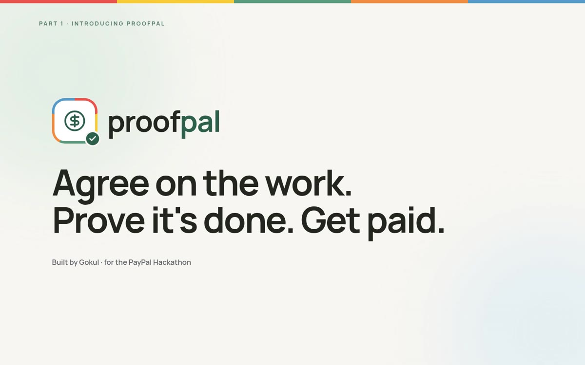
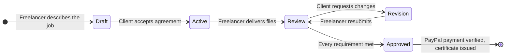
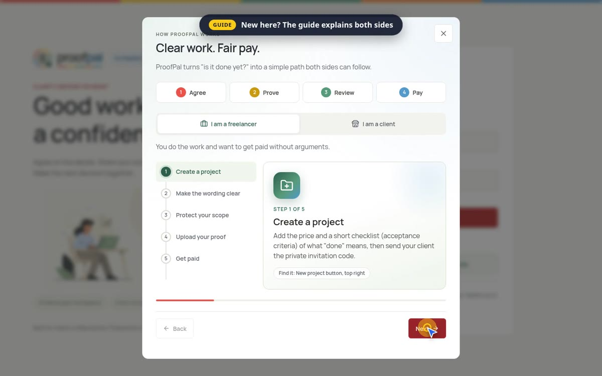
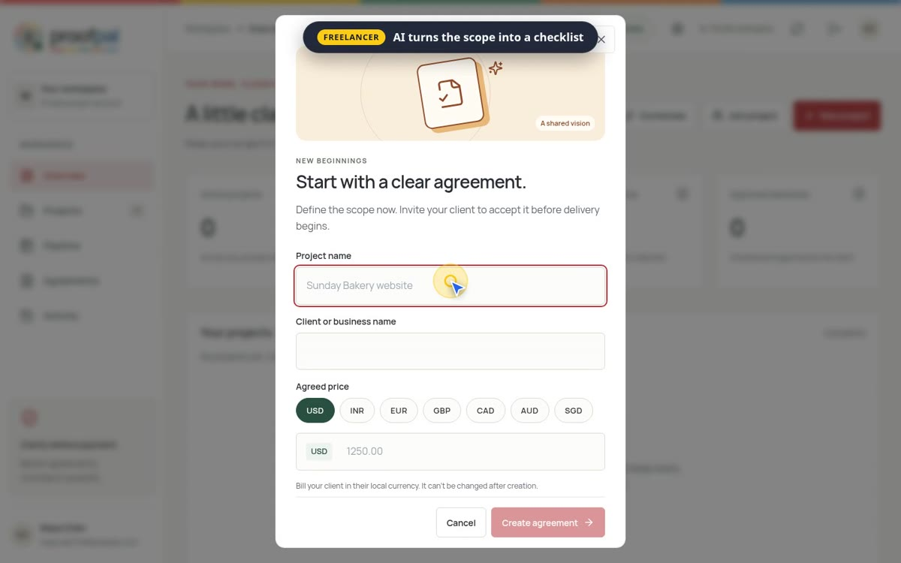
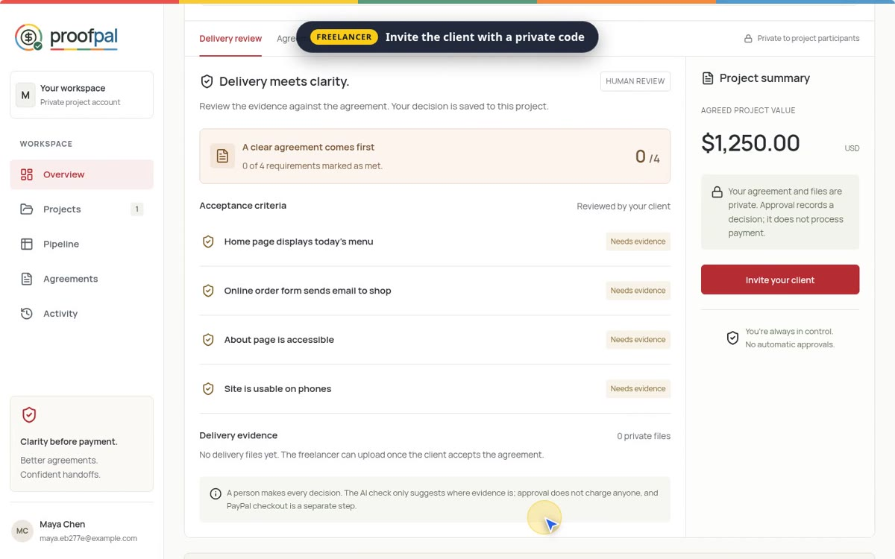
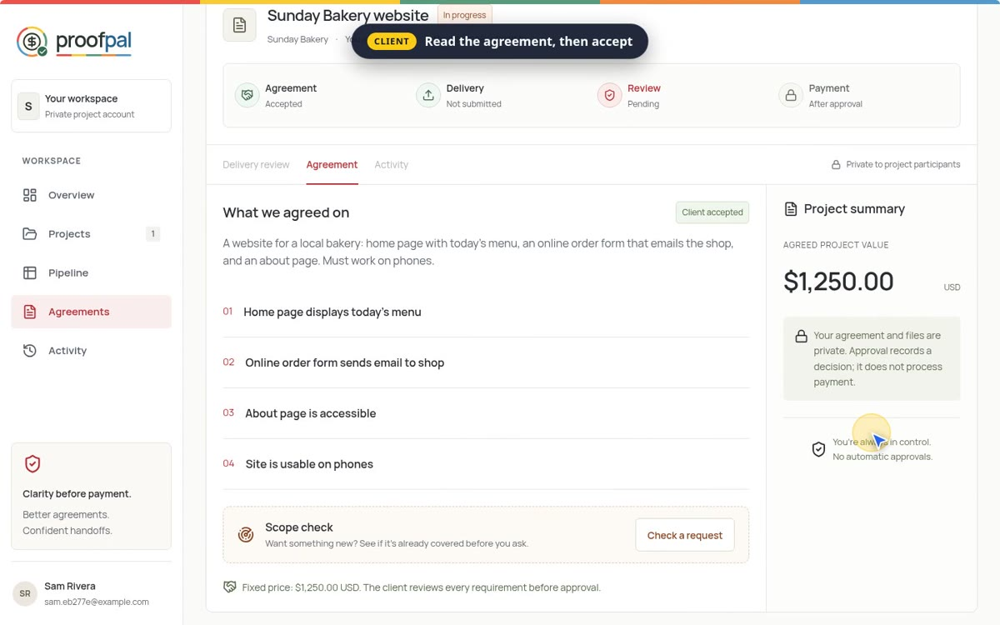
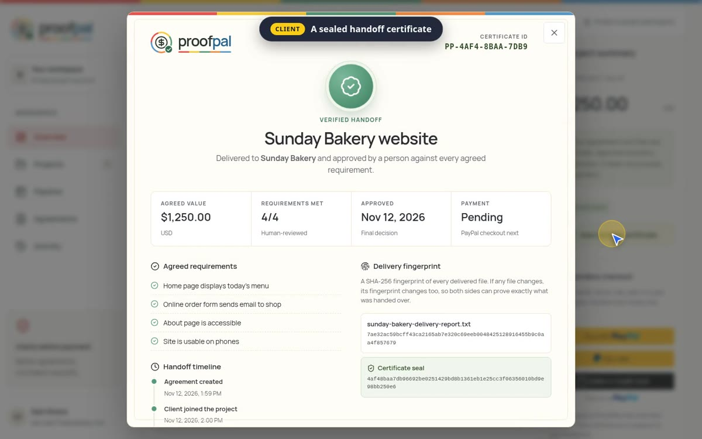
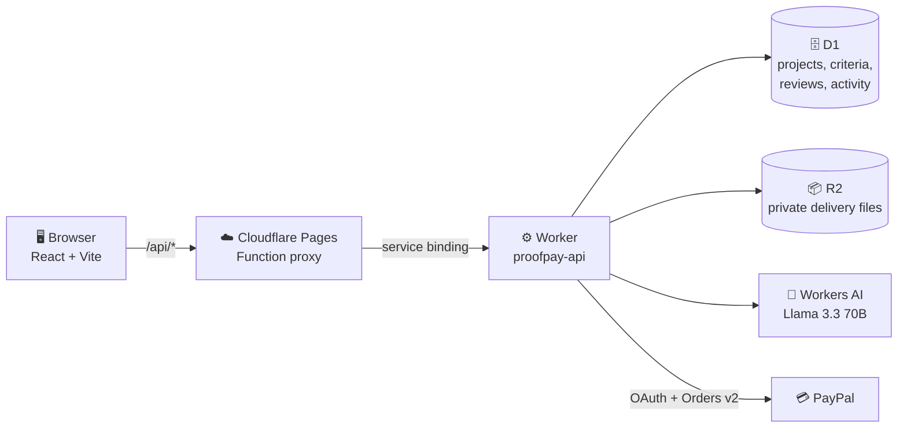
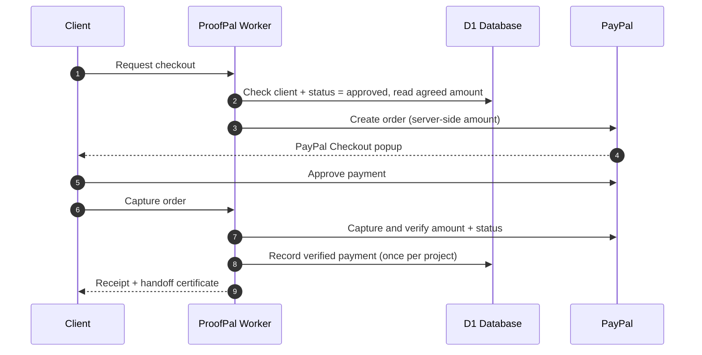

<div align="center">



<br />

# ProofPal

## $\color{#ea534c}{\textsf{Agree on the work.}}$ $\color{#d4a017}{\textsf{Prove it's done.}}$ $\color{#589b7c}{\textsf{Get paid.}}$

**The freelance workflow where "done" is defined up front, proven with evidence, approved by a human, and settled through PayPal, with a verifiable record at every step.**

<br />

[](https://proofpal.pages.dev)
[](https://youtu.be/nvNLsUKzVAE)
[](#-built-for-the-paypal-ai-hackathon)


<br />

[Demo](#-demo-video) · [Problem](#-the-problem) · [How it works](#-how-it-works) · [PayPal + AI](#-how-paypal-and-ai-power-proofpal) · [Features](#-features) · [Architecture](#%EF%B8%8F-architecture) · [Security](#-trust-and-security-by-design) · [Try it](#-try-it-in-3-minutes) · [Run it](#-run-it-locally)

</div>

<br />

## 🎬 Demo video

<div align="center">

<a href="https://youtu.be/nvNLsUKzVAE">
  
</a>

<br />

**[▶ Watch the full walkthrough on YouTube](https://youtu.be/nvNLsUKzVAE)** · 2 min 52 s · freelancer side and client side, end to end

</div>

<br />


## 💥 The problem

Most freelance disputes aren't about money. They're about the word **"done."**

<table>
<tr>
<td width="50%" align="center">

🧑‍💼 **Client**

*"Is it done yet?"*

</td>
<td width="50%" align="center">

🧑‍💻 **Freelancer**

*"When do I get paid?"*

</td>
</tr>
</table>

Nobody wrote down what "done" meant, so it turns into an argument:

- 📝 **Vague briefs**: "make it modern and fast" can't be checked by anyone.
- 🌊 **Scope creep**: new requests slip in through casual messages, unpaid.
- 📂 **Scattered proof**: deliverables live across email threads and chat apps.
- 💸 **Disconnected payment**: paying has no link to what was actually delivered.

## ✨ The solution

ProofPal turns a vague job description into **one shared source of truth** that follows the project from the first agreement to the final payment.

<table>
<tr>
<th width="25%">1️⃣ Agree</th>
<th width="25%">2️⃣ Prove</th>
<th width="25%">3️⃣ Review</th>
<th width="25%">4️⃣ Pay</th>
</tr>
<tr valign="top">
<td>The freelancer describes the job in plain words. <b>AI drafts a checklist</b> of acceptance criteria that can actually be checked. The client joins with a <b>private invite code</b> and accepts.</td>
<td>The freelancer uploads delivery files into <b>private storage</b>. The client sees exactly what was handed over, linked to each requirement.</td>
<td>The client reviews item by item. An <b>AI second opinion</b> flags weak or missing evidence, but <b>only the person decides</b>.</td>
<td>Once every requirement is approved, the client pays through <b>PayPal Checkout</b>. Both sides get a <b>handoff certificate</b> with a SHA-256 fingerprint of every file.</td>
</tr>
</table>

> [!IMPORTANT]
> **AI advises, people decide.** The AI drafts criteria and points out gaps, but it can never approve work, reject work, or trigger a payment.


## 🔄 How it works



Every arrow is enforced by the server. Steps can't be skipped, reordered or replayed.


## 🤝 How PayPal and AI power ProofPal

<table>
<tr valign="top">
<td width="50%">

### $\color{#0070e0}{\textsf{PayPal developer platform (sandbox)}}$

| Tool | What it does in ProofPal |
| :-- | :-- |
| **PayPal JavaScript SDK** | Renders the PayPal Smart Buttons (PayPal, Pay Later, Venmo, card) in the client's checkout. |
| **Orders API v2: create** | The Worker creates the order with the amount and currency taken from the stored agreement, never from the browser. |
| **Orders API v2: capture** | The Worker captures the approved order and checks status, amount and currency before recording the payment. |
| **OAuth 2.0 client credentials** | Server-side access tokens. The secret never reaches the browser. |
| **PayPal-Request-Id** | Idempotency keys so retries can never double-charge. |

</td>
<td width="50%">

### $\color{#d4a017}{\textsf{AI: Cloudflare Workers AI}}$

Model: **Meta Llama 3.3 70B Instruct** (`@cf/meta/llama-3.3-70b-instruct-fp8-fast`)

| Feature | What the AI does |
| :-- | :-- |
| **Criteria drafting** | Turns a plain-language brief into clear, testable acceptance criteria. |
| **Revision drafting** | Writes a polite revision request from the requirements still open. |
| **Evidence check** | Reviews delivered files against each requirement and flags weak or missing proof. |

> [!IMPORTANT]
> The AI is advisory only. It can never approve, reject or pay.

</td>
</tr>
</table>

### $\color{#0e4491}{\textsf{Sponsor tool: AG Grid}}$

The **project pipeline** and the **criteria tracker** are built on **AG Grid Community** (React): sorting, quick search, pagination, row animations, CSV export and a custom Quartz theme matched to the ProofPal palette, with custom cell renderers for status pills, progress and amounts.


## 📸 Screenshots

<table>
<tr>
<td width="50%"><p align="center"><b>Guided onboarding</b><br/><sub>Separate paths for freelancers and clients</sub></p></td>
<td width="50%"><p align="center"><b>New agreement</b><br/><sub>Plain-language brief, price and currency</sub></p></td>
</tr>
<tr>
<td width="50%"><p align="center"><b>AI-drafted criteria and private invite</b><br/><sub>Testable requirements, one-time code</sub></p></td>
<td width="50%"><p align="center"><b>Client acceptance</b><br/><sub>Read everything before work begins</sub></p></td>
</tr>
<tr>
<td colspan="2" align="center"><p align="center"><b>Sealed handoff certificate</b><br/><sub>What was agreed, delivered, approved and paid, fingerprinted</sub></p></td>
</tr>
</table>


## 🚀 Features

<table>
<tr valign="top">
<td width="50%">

### 🧑‍💻 For freelancers

- 🤖 **AI checklist drafting**: turns a plain brief into clear, testable requirements.
- 🎯 **Clarity score**: flags vague words like "modern", "fast" or "nice" before the client signs.
- 🛡️ **Scope check**: paste a new client request and see if it's covered or counts as extra, paid work. Out-of-scope requests become a ready-to-send change order with a price and timeline.
- 🔐 **Private invites**: a one-time code per project, so only the intended client can join.
- 🔁 **Revision loop**: revise and resubmit on the same agreement.

</td>
<td width="50%">

### 🧑‍💼 For clients

- 📜 **Read before you accept**: scope, price and currency are locked before work starts.
- ✅ **Requirement-by-requirement review**: mark each item as met or needing changes, with notes.
- 🧠 **AI second opinion**: highlights weak evidence, advice only.
- 💳 **PayPal Checkout**: pay securely once everything is approved. The amount comes from the server, never the browser.
- 🏅 **Handoff certificate**: a downloadable record with a SHA-256 fingerprint of every delivered file.

</td>
</tr>
</table>

**Throughout the app:** an animated "How it works" guide, a pipeline board, an activity timeline, multi-currency estimates (USD, INR, EUR, GBP, CAD, AUD, SGD), and a responsive layout for desktop and mobile.


## 🏗️ Architecture



### 💳 Payment flow



### 🧰 Tech stack

| Layer | Technology |
| :-- | :-- |
| 🎨 **Frontend** | React 18, TypeScript, Vite, Tailwind CSS, Lucide icons, AG Grid |
| ☁️ **Hosting** | Cloudflare Pages, with a Pages Function that proxies `/api` to the Worker |
| ⚙️ **API** | Cloudflare Worker (TypeScript) |
| 🗄️ **Database** | Cloudflare D1 (SQLite), schema in `worker/migrations` |
| 📦 **File storage** | Cloudflare R2, private bucket |
| 🤖 **AI** | Workers AI, `@cf/meta/llama-3.3-70b-instruct-fp8-fast` |
| 💳 **Payments** | PayPal REST: OAuth client credentials and Orders API v2 (sandbox) |


## 🔒 Trust and security by design

| | Guarantee | How |
| :-: | :-- | :-- |
| 🚦 | **Server-enforced state machine** | Each move is an atomic database update that checks the current status. Approval requires every requirement to be met, and only the client can pay. |
| 👥 | **Records scoped to participants** | Every query is limited to the project owner or the invited client. |
| 🔑 | **Hashed secrets** | Invite codes are stored only as hashes. Passwords use PBKDF2 with 100k iterations. |
| 💳 | **Payments verified server-side** | The order amount is computed from the stored agreement, and the capture is checked with PayPal before a project is marked paid. |
| 🤖 | **AI is advisory only** | It drafts and comments. It never approves, rejects or pays. |
| 📦 | **Private files** | Uploads are capped at 10 MB, streamed into a private R2 bucket, and only served to project participants. |

> [!NOTE]
> Payments run in **PayPal sandbox** mode: test money only, paid to the app's sandbox merchant account. Each project can be paid exactly once, and every PayPal call uses an idempotency key so retries can't double-charge.

> [!TIP]
> The full API is documented as an OpenAPI 3 spec in [`public/openapi.json`](public/openapi.json).


## 🧪 Try it in 3 minutes

> [!TIP]
> Use two browsers (or one normal and one private window) so you can play both sides.

| Step | $\color{#326c52}{\textsf{Freelancer window}}$ | $\color{#24658f}{\textsf{Client window}}$ |
| :-: | :-- | :-- |
| 1 | Sign up at [proofpal.pages.dev](https://proofpal.pages.dev) and create a project with a short brief and a price. Let the AI draft the criteria. | |
| 2 | Copy the private invite code. | Sign up with a different email and join with the invite code. Accept the agreement. |
| 3 | Upload a delivery file and submit for review. | |
| 4 | | Run the AI evidence check, mark each requirement as met, and approve. |
| 5 | | Pay with PayPal using a **PayPal sandbox personal account** or the card option with a sandbox test card. |
| 6 | Open the handoff certificate. | Open the receipt and handoff certificate. |


## 🏆 Built for the PayPal AI Hackathon

| Requirement | How ProofPal meets it |
| :-- | :-- |
| 💳 **PayPal integration** | PayPal Checkout with server-side order creation and capture verification (Orders API v2). Payment is the final, verified step of every project. |
| 🤖 **Meaningful AI** | Llama 3.3 70B drafts testable acceptance criteria, rewrites them on revision, and gives clients a second opinion on delivered evidence. |
| 🧪 **Working application** | Fully deployed at [proofpal.pages.dev](https://proofpal.pages.dev), with an end-to-end test against the live deployment. |
| 🧩 **Sponsor tool** | AG Grid powers the project pipeline and criteria tracker. |
| 📖 **Open source** | MIT licensed. |


## 💻 Run it locally

```bash
npm install
npm run dev            # frontend on http://localhost:5173
npm run typecheck      # app + worker type checks
npm run build          # production build into dist/
```

<details>
<summary><b>☁️ Deploy to Cloudflare</b></summary>

<br />

```bash
npm run database:apply   # apply D1 migrations
npm run deploy:worker    # deploy the API worker
npm run deploy:pages     # build and deploy the frontend to Pages
```

The Worker needs one secret, the PayPal sandbox secret:

```bash
npx wrangler secret put PAYPAL_SECRET --config wrangler.worker.toml
```

</details>

<details>
<summary><b>🧪 End-to-end check</b></summary>

<br />

```bash
python3 tests/cloudflare_workflow.py https://proofpal.pages.dev
```

Runs the full flow against a live deployment: sign up, create a project, invite, accept, deliver, review and approve.

</details>

<details>
<summary><b>📁 Project structure</b></summary>

<br />

```
src/
  components/      UI: project detail, criteria grid, scope guard, AI check, PayPal, certificate, guide
  lib/             API client, clarity scoring, scope matching, grid helpers
worker/
  index.ts         API routes and the project state machine
  auth.ts          sessions and password hashing
  ai.ts            Workers AI prompts (criteria, revisions, evidence check)
  paypal.ts        PayPal OAuth, order creation and verification
  migrations/      D1 schema
functions/api/     Pages Function proxy to the Worker
tests/             end-to-end workflow check
```

</details>

---

<div align="center">

  

<br /><br />

Built by **Gokul** for the **PayPal AI Hackathon 2026** · Released under the [MIT License](LICENSE)

[🌐 Live App](https://proofpal.pages.dev) · [🎬 Demo Video](https://youtu.be/nvNLsUKzVAE)

</div>
